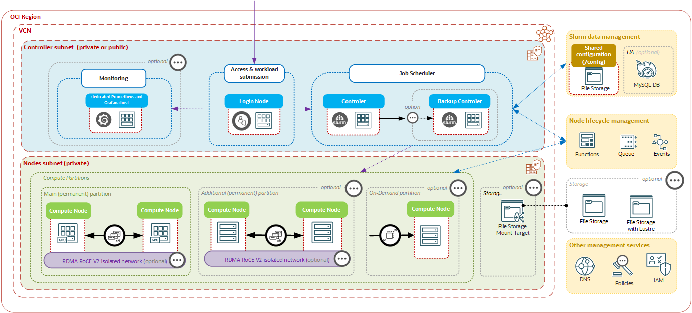

# OCI HPC Cluster Architecture

OCI HPC/GPU Cluster Stack is an infrastructure and configuration stack, not a
single application. Terraform provisions OCI resources, shell scripts bootstrap
the hosts, Ansible configures the hosts, and Python components
provide lifecycle automation and ongoing management.

## Planes

The deployment has three logical planes:

| Plane | Components | Purpose |
| --- | --- | --- |
| Control | Controller, optional backup, management database, optional HeatWave MySQL | Slurm, Ansible, inventory, lifecycle state, accounting |
| Access and observability | Login and monitoring nodes | User entry, Grafana, Prometheus |
| Workload | Compute nodes and shared storage | Jobs, accelerators, application data |

OCI Events, Functions, Queue, private DNS, IAM, and tagging connect the planes
and automate node membership.

## Shared configuration filesystem

The stack always creates a dedicated OCI File Storage filesystem, mount target,
and `/config` export. Private DNS publishes it as
`fss-config-<cluster_name>.<zone_name>`. The controller mounts and populates
it with inventories, keys, playbooks, scripts, configuration, and logs; all
other nodes mount the same export during bootstrap.

Optional FSS/NFS settings add workload or home-directory filesystems. They do
not replace the stack-managed `/config` export.

## Controller

The controller is provisioned first. Terraform copies configuration,
playbooks, scripts, inventory, and an internally generated SSH key to it. The
controller populates the mounted `/config`, installs dependencies, and runs
the site playbook. It later consumes lifecycle queue messages and runs targeted
configuration for nodes joining or leaving the cluster.

Each configured node exposes inventory metadata through the stack's Host API
on port 9876. Controller services scan that metadata, update the management
database, and finalize cluster-wide configuration such as Slurm topology,
health metadata, and Prometheus targets.

## Compute topology

`rdma_enabled`, `stand_alone`, the selected shape, and existing-cluster inputs
determine whether compute capacity uses a cluster network, compute cluster,
GPU memory cluster, independent RDMA instances, an instance pool, or ordinary
instances. Keep controller and compute placement compatible with OCI shape and
availability-domain requirements.

## Configuration ownership

- Terraform owns OCI resources and initial connection and provisioning steps.
- Ansible owns host configuration and installed services.
- The `mgmt` management CLI owns supported runtime operations.
- Operators own workload, user, quota, backup, and capacity policy.

Avoid editing generated files under `/config` without recording the source
change; later automation can overwrite local modifications.
