# Monitoring and alerting

The following is the documentation for Monitoring components deployed as part of our Slurm HPC stack. This guide is divided into three parts: Deployment, User Guide, and Operations. Deployment covers the stack configuration and specific deployment notes such as ports used by exporters. The User Guide walks you through dashboards and alerts, and the Operations section covers maintenance activities, tips, and other operational details. 

## Deployment

### Architecture

The monitoring stack deployed as part of the HPC deployment primarily consists of three components:
- Grafana instance that hosts pre-built, ready-to-use dashboards and pre-provisioned alert rules.
- Prometheus instance that scrapes metrics from exporters running on nodes and includes recording rules for aggregations used to calculate health.
- Exporters that run on individual instances. 


### Stack Configuration

During stack deployment via Resource Manager, the "Cluster Monitoring" section provides several options for installing and configuring monitoring.

Ideally you should enable all options for a standard deployment, but these can be customized as needed.

**Install HPC Cluster Monitoring Tools** — check this flag (blue check mark) to install Prometheus, Grafana (on the controller/monitoring node), and metrics exporters (compute nodes). Installation is automatic.

**Enable Slurm job monitoring** — check this flag to enable Slurm-specific monitoring. This installs the Slurm REST exporter, the DB-backed Slurm job exporter, Slurm dashboards, and compute-node job/GPU utilization writes from the NVML exporter. Leave it unchecked when you only need base system, node, GPU, storage, network, and OCI monitoring.

**Slurm monitoring MySQL backend** — choose where Slurm job monitoring stores job accounting and utilization data. This option appears only when Slurm job monitoring is enabled. Choose **local** to use the controller-local MySQL service. This is useful for testing, proof of concept deployments, and small clusters because it does not create an OCI managed MySQL DB System only for monitoring. Choose **managed** to use an OCI managed MySQL DB System. Managed is the default and is recommended for larger or production deployments. If you choose managed, configure the shared DB System in **Database Options** by selecting the MySQL shape and setting the MySQL administrator username and password. When Slurm HA is enabled, Slurm job monitoring reuses the same managed MySQL instance with a separate monitoring database and users.

Slurm and monitoring database deployment options:

| Slurm job monitoring | Slurm HA | Monitoring backend selection | Effective database deployment | Database Options required | Result |
| --- | --- | --- | --- | --- | --- |
| Disabled | Disabled | Hidden and unused | No monitoring database is created | No | Base cluster monitoring only; Slurm job exporters and job dashboards are not installed. |
| Enabled | Disabled | **local** | MySQL on the controller | No | Ansible creates `slurm_jobs`, its tables, and monitoring users in the controller-local MySQL service. |
| Enabled | Disabled | **managed** | OCI managed MySQL DB System | Yes | Terraform creates the managed DB System and Ansible creates `slurm_jobs`, its tables, and monitoring users on it. |
| Disabled | Enabled | Hidden and unused | OCI managed MySQL DB System for Slurm HA | Yes | Slurm HA uses managed MySQL for Slurm accounting; the `slurm_jobs` monitoring database and job exporters are not created. |
| Enabled | Enabled | Hidden; automatically forced to **managed** | One shared OCI managed MySQL DB System | Yes | Slurm HA accounting and monitoring reuse the same DB System but use separate databases and credentials. Ansible creates `slurm_jobs`, its tables, and monitoring users. |

The **local** monitoring backend is not available when Slurm HA is enabled. The local/managed selector is hidden in Resource Manager for HA deployments, and Terraform makes `managed` the effective backend for deployments performed outside the schema UI as well.

When Slurm job monitoring is enabled, Ansible creates the `slurm_jobs` monitoring database, required tables and indexes, and two generated monitoring users. The `slurm_exporter` user is granted `SELECT`, `INSERT`, `UPDATE`, `DELETE`, `CREATE`, `ALTER`, and `INDEX` on `slurm_jobs.*`. The `slurm_grafana` user is granted `SELECT` on `slurm_jobs.*`.

#### Slurm job monitoring data flow

The monitoring MySQL participant below represents either controller-local MySQL or the OCI managed MySQL DB System selected by the deployment options above.

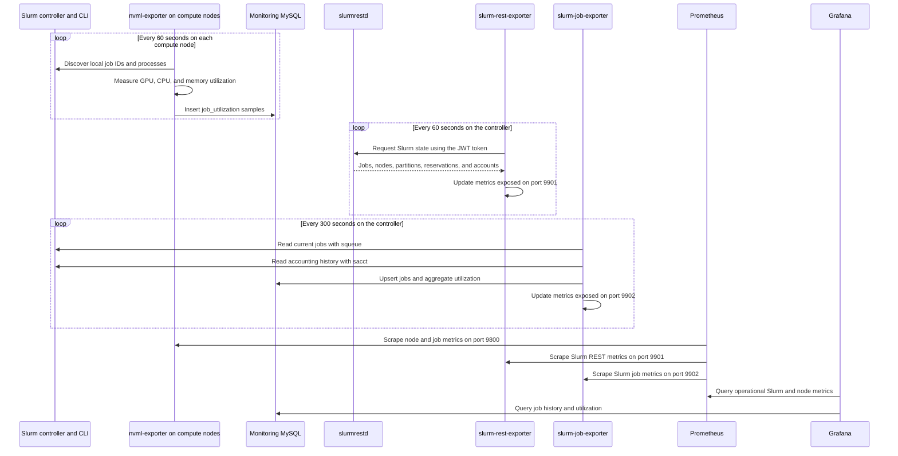

#### NCCL inspector data flow

NCCL Inspector is installed on NVIDIA GPU compute nodes when cluster monitoring is enabled. The plugin is built from the installed NCCL source tag when it is at least 2.31.2; for older runtimes, the playbook builds it from the 2.31.2 source tag. The runtime NCCL version is not changed. The source tarball and built plugin are cached for other nodes. JSON dumps require `slurm_job_monitoring` and its collector service. OTLP metrics use the per-node otelcol agent.

The default JSON dump root is `/config/metrics/nccl-inspector`. Set `nccl_inspector_dump_dir` to change it; the job and collector must use the same shared root. The recommended dump/export interval is 5,000,000 microseconds (5 seconds). The collector polls every 30 seconds by default; change `nccl_inspector_collector_interval_seconds` to adjust it.

Choose a mode on the [Slurm sample](../samples/gpu/nccl_run_allreduce.sbatch) or [shell sample](../samples/gpu/nccl_run_allreduce.sh) with `--with-nccl-inspector-jsonl` or `--with-nccl-inspector-otel`. The job launcher sets the required environment variables.

```bash
# JSON dumps (default): per-rank JSONL dumps collected into MySQL
export NCCL_PROFILER_PLUGIN=libnccl-profiler-inspector.so
export NCCL_INSPECTOR_ENABLE=1
export NCCL_INSPECTOR_DUMP_THREAD_INTERVAL_MICROSECONDS=5000000
# For large jobs or a shorter drain interval, use a high-performance shared
# filesystem for NCCL_INSPECTOR_DUMP_DIR.
# Ensure nccl-inspector-collector.service on the monitoring node uses the
# same shared root directory. The job directory should be below that root.
export NCCL_INSPECTOR_DUMP_DIR=/config/metrics/nccl-inspector/job-$SLURM_JOB_ID
# Pre-create the per-job dump dir before launching ranks: the plugin treats
# a concurrent mkdir by another rank as fatal and that rank records nothing
mkdir -p "$NCCL_INSPECTOR_DUMP_DIR"
```

```bash
# OTLP metrics: export the above (including the mkdir -p) plus this opt-in
# (JSON dumps are skipped)
export NCCL_INSPECTOR_OTEL_EXPORT=1
# Endpoint is required on this stack: the plugin default (localhost) resolves
# to ::1 on the GPU images while otelcol listens on IPv4 127.0.0.1.
export OTEL_EXPORTER_OTLP_METRICS_ENDPOINT=http://127.0.0.1:4318/v1/metrics
```

The `mkdir -p` in the JSON snippet is required in **both** modes: every rank's dump thread creates the per-job dump directory at startup, and the plugin treats a concurrent `mkdir` by another rank (`EEXIST`) as fatal — the losing ranks silently record nothing (in OTEL mode they never export; in JSON mode they never write dumps). Multi-rank runs must therefore pre-create `NCCL_INSPECTOR_DUMP_DIR` in the launcher (sbatch script) before `mpirun`/`srun`; single-rank runs are unaffected, and re-runs into an existing directory are safe.

- **JSON dumps (default).** The inspector writes per-rank JSONL dumps to the per-job directory under the shared dump directory (`NCCL_INSPECTOR_DUMP_DIR`, e.g. `/config/metrics/nccl-inspector/job-$SLURM_JOB_ID`). Point it inside the shared dump directory — the `nccl-inspector-collector` service on the monitoring node only watches that tree. The collector tails the dumps and inserts per-operation collective records into the `nccl_inspector_coll_perf` table of the monitoring MySQL database (`slurm_jobs`), following the NIXT analysis flow: communicator identity, `coll_perf` fields (collective, sequence number, message size, exec time, algo/bus bandwidth), dump metadata, plus derived `comm_type` (single-rank / nvlink-only / hca-only / mixed) and `slurm_job_id`. Inserts are idempotent per `(slurm_job_id, hostname, pid, comm_id, rank, coll_sn)`; rows and finished job directories older than `nccl_inspector_retention_days` are purged.
- **OTLP metrics (opt-in).** Export `NCCL_INSPECTOR_OTEL_EXPORT=1` in the job environment (e.g. `export` in the sbatch script or `sbatch --export`). The inspector pushes aggregated metrics to the per-node otelcol agent (`http://127.0.0.1:4318/v1/metrics`), which exposes them for Prometheus on port 8889. JSON dumps are skipped entirely in this mode. The **NCCL Inspector Job Performance** dashboard (variables: Slurm job, node) visualizes bus bandwidth and exec time per collective and P2P operation, split by NVLink-only vs multi-node. In Prometheus, otelcol exposes the bus-bandwidth instruments with the exporter's unit suffix (`nccl_bus_bandwidth_gbs_GB_per_second` and `nccl_p2p_bus_bandwidth_gbs_GB_per_second`), while the exec-time instruments already embed their unit (`nccl_collective_exec_time_microseconds` and `nccl_p2p_exec_time_microseconds`); the dashboard queries these exact names.

**Recommendation for large-scale JSONL workloads.** With many ranks, high collective rates, or a short drain interval, per-rank JSONL dumps grow quickly and the default `/config` NFS share can become a write bottleneck (ranks block on dump writes, and the collector tail lags). Move the dump root to a faster shared filesystem — for example an NVMe-backed parallel filesystem (Lustre, BeeGFS) or a high-performance FSS mount — keep the per-job layout (`<shared-root>/job-$SLURM_JOB_ID`), and point the collector at the same root. Both sides must always agree, since the collector only watches its configured directory:

- With playbook control: set the `nccl_inspector_dump_dir` role default (default `/config/metrics/nccl-inspector`) and re-run the monitoring playbook, which renders the new root into `nccl-inspector-collector.service`.
- Operational change without a playbook run: edit the collector's environment directly in `/etc/systemd/system/nccl-inspector-collector.service` on the monitoring node, then `sudo systemctl daemon-reload && sudo systemctl restart nccl-inspector-collector`. The service file is what the collector reads at runtime, so the other collector knobs — `NCCL_INSPECTOR_POLL_INTERVAL` and `NCCL_INSPECTOR_RETENTION_DAYS` — are adjusted the same way.

Jobs continue to set `NCCL_INSPECTOR_DUMP_DIR=<shared-root>/job-$SLURM_JOB_ID` under whichever root is configured.

Per-job environment reference (all exported by the user in the job; nothing is injected automatically):

| Variable | JSON | OTLP | Notes |
| --- | --- | --- | --- |
| `NCCL_PROFILER_PLUGIN=libnccl-profiler-inspector.so` | required | required | Loads the plugin; same value in both modes |
| `NCCL_INSPECTOR_ENABLE=1` | required | required | Master switch (plugin default is off) |
| `NCCL_INSPECTOR_DUMP_THREAD_INTERVAL_MICROSECONDS` | required | required | Drain/export cadence, recommended 5000000 (5s) |
| `NCCL_INSPECTOR_DUMP_DIR=/config/metrics/nccl-inspector/job-$SLURM_JOB_ID` | required | created, not written | JSON: must point inside the shared dump directory (default `/config/metrics/nccl-inspector`); the collector only watches that tree. OTLP: no dumps are written and the collector does not read it, but the plugin still resolves and creates this directory at startup, so pre-create it with `mkdir -p` to avoid the concurrent-mkdir race described above. |
| `NCCL_INSPECTOR_OTEL_EXPORT=1` | must be unset | required | Selects OTLP mode; the plugin gives it precedence over JSON dumps |
| `OTEL_EXPORTER_OTLP_METRICS_ENDPOINT` | ignored | required | Must be `http://127.0.0.1:4318/v1/metrics` (per-node otelcol agent); the plugin default (`http://localhost:4318/v1/metrics`) fails because `localhost` resolves to `::1` on the GPU images |

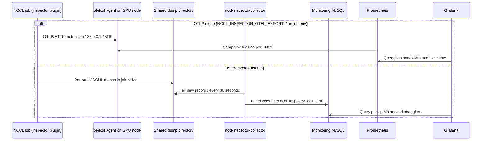

The plugin drains completed operations every 5 seconds by default. Use multi-rank collectives; single-rank runs produce no records. Launchers create the per-job dump directory before starting ranks to avoid a concurrent-directory creation race. JSON offsets are stored in `/var/lib/nccl-inspector-collector/state.json`, and old rows and job directories are removed after the configured retention period. Directory cleanup requires **Sudo Access** (`privilege_sudo=true`) for `cluster_admin_user` on the monitoring host; with it disabled, old database rows are removed but user-owned dump directories remain. The **NCCL Inspector** dashboard is imported when Slurm job monitoring is enabled.

**Enable LDAP for Grafana UI** — check this flag if you want Grafana to authenticate users against the cluster LDAP directory during deployment. This option is shown only when both cluster monitoring and cluster LDAP are enabled. If left unchecked, Grafana continues to use local Grafana users only. If you later want to disable Grafana LDAP on an existing cluster, use `scripts/ldap/disable_grafana_ldap.py` on the Grafana host rather than editing the stack.

**Use Let's Encrypt Production Endpoint** — check this flag to enable SSL for the Grafana dashboard using a custom URL in the format `"https://grafana.PUBLIC-IP.endpoint.oci-hpc.ai"`; this URL will be shown in the stack output and logs. See the section below for how to obtain the Grafana URL and admin password after stack creation.

**Install HPC Cluster alerting tools** — check this flag to create an OCI Notifications Topic and a webhook that runs on the controller/monitoring node as part of the stack deployment. See the section below on configuring a Slack subscription to send alerts to a Slack channel.

**Ingest OCI metrics in Prometheus** — check this flag to include OCI service metrics in Prometheus. We provide pre-built dashboards for these metrics so you can view cluster and OCI service metrics in a single Grafana instance, avoiding the need to log in to the OCI Console to view metrics or build custom dashboards there. 

**Monitoring Node** — by default, if this option is not checked, monitoring is installed on the controller node. If you have left the controller node at its default size, hosting Prometheus, Grafana, and Slurm on the same node requires additional resources. If you do not use a separate monitoring node, ensure the controller node has sufficient CPU and memory. If you check this option, you can install Prometheus and Grafana on a separate node by specifying options such as **shape of the monitoring node, availability zone, number of cores, custom memory size, and boot volume size**. 

### Suggested monitoring node sizes

Each range is sized for its upper limit. Use the formulas below for a more
precise estimate within a range.

#### Dedicated monitoring node

| Compute nodes | OCPU | Memory | Boot volume |
| --- | ---: | ---: | ---: |
| Up to 16 | 4 | 8 GiB | 100 GiB |
| 17–32 | 4 | 8 GiB | 150 GiB |
| 33–64 | 4 | 12 GiB | 200 GiB |
| 65–128 | 8 | 20 GiB | 300 GiB |
| 129–256 | 8 | 36 GiB | 500 GiB |
| 257–512 | 8 | 64 GiB | 900 GiB |
| 513–1024 | 8 | 120 GiB | 1700 GiB |

#### Monitoring on controller node

The baseline controller without monitoring is 4 OCPUs, 16 GiB of memory, and a
100 GiB boot volume. Add the following values to that baseline.

| Compute nodes | OCPU add-on | Memory add-on | Boot volume add-on |
| --- | ---: | ---: | ---: |
| Up to 16 | +4 | +2 GiB | +50 GiB |
| 17–32 | +4 | +4 GiB | +100 GiB |
| 33–64 | +4 | +8 GiB | +150 GiB |
| 65–128 | +8 | +15 GiB | +250 GiB |
| 129–256 | +8 | +29 GiB | +450 GiB |
| 257–512 | +8 | +57 GiB | +850 GiB |
| 513–1024 | +8 | +114 GiB | +1650 GiB |

For example, with 16 compute nodes, the controller requires 8 OCPUs and 18 GiB
of memory: the 4 OCPU and 16 GiB controller baseline plus the 4 OCPU and 2 GiB
monitoring add-on. A controller configured with 8 OCPUs and 32 GiB of memory is
sufficient for CPU and memory. Its boot volume must be at least 150 GiB: the
100 GiB baseline plus the 50 GiB monitoring add-on.

To validate the controller baseline on an existing cluster, collect a
representative busy period:

```bash
./scripts/service_usage_stats.sh \
  --service slurmctld.service \
  --service slurmdbd.service \
  --service mariadb.service \
  --duration-hours 24 \
  --interval-seconds 60 \
  --output controller_usage_24h.csv

python3 scripts/controller_baseline_sizing.py \
  --input controller_usage_24h.csv \
  --observed-nodes 16
```

The collector reads systemd accounting without changing or querying the Slurm
daemons. Use `mysqld.service` instead of `mariadb.service` where applicable.
The calculator reports combined p99 CPU and memory usage and an estimated
controller baseline. Set `--observed-nodes` to the compute-node count during
collection. Use the calculator's `--help` option to adjust the reserves,
buffers, minimum size, or vCPU-to-OCPU ratio. Run the collector during a
representative workload; the result does not include unselected services or
replace whole-host capacity validation.

These starting sizes include a 25% memory buffer and a 50% CPU buffer. For a
cluster with `N` compute nodes, calculate the values as follows:

```text
Monitoring memory = 0.111 GiB x N
Dedicated memory = add 4 GiB, round up to the next 4 GiB, minimum 8 GiB
Controller memory add-on = round up to the next GiB, minimum 2 GiB

Monitoring CPU = 0.000705 OCPU x N
Dedicated OCPU = add 1 OCPU and round up; minimum 4 below 128 nodes,
                 minimum 8 from 128 nodes
Controller OCPU add-on = round up; minimum 4 below 128 nodes,
                         minimum 8 from 128 nodes

Monitoring disk = 1.572 GiB x N
Dedicated boot = add 50 GiB and round up to the next 50 GiB
Controller boot = add monitoring disk to the 100 GiB baseline, then round up
Controller boot add-on = rounded controller boot minus 100 GiB
```

The `1.572 GiB` disk coefficient is based on approximately 260.4 ingested
samples per second per compute node, 30 days of retention, and 2 bytes per
sample. It already includes 25% headroom; do not apply another 25% buffer.

For an existing representative cluster, run the data-driven estimator on the
monitoring host:

```bash
python3 scripts/monitoring_node_sizing.py \
  --environment production-a \
  --target-nodes 128 \
  --retention-days 30
```

The script uses the previous seven days of Prometheus process metrics and a
short sample from Grafana's `/metrics` endpoint. `--environment` is only an
output label; the script does not SSH to cluster nodes. `--current-nodes`
overrides automatic compute-node discovery, and `--json` produces a result that
can be retained for comparison. The sizing table assumes 30-day retention, so
use `--retention-days 30` when comparing estimator output with the table. If
the option is omitted, the estimator uses the retention reported by the running
Prometheus instance, which is 15 days on a default deployment.

Run the estimator on at least two representative environments and use the
larger observed coefficients. Recheck approximately every three months and
after changing exporters, scrape intervals, retention, dashboards, or alert
rules. The script recalculates the coefficients from the observed environment
and applies the same buffers, minimums, and rounding used in the table.

For controller-hosted monitoring, add the script's controller values to the
controller's normal requirement instead of applying the dedicated-node base.
The default conversion is two vCPUs per OCPU; use `--vcpus-per-ocpu` for other
shapes. Treat the result as observed guidance, not a universal minimum, and
round up to a supported OCI shape.


### Monitoring Configuration

Monitoring installs and configures Prometheus, Grafana, and exporters on specific ports. The following table lists ports, components, and their usage:

| Port | Systemd Service Name | Where it runs | What it does |
| --- | --- | --- | --- |
| 3000 or 443 | grafana-server | Grafana | Dashboards |
| 5000 | ons-webhook | Grafana Webhook for OCI Notifications | Deliver alerts via Slack, Email etc. |
| 6820 | slurmrestd | controller | Slurm REST API used by the Slurm REST exporter |
| 9090 | prometheus | monitoring or controller | Exposes Prometheus metrics for scraping |
| 9100 | node-exporter and customMetrics | compute, login and controller | Node metrics and custom health check metrics |
| 9273 | telegraf | controller | Metrics for OCI Services via telegraf |
| 9400 | dcgm-exporter (NVIDIA) or amd-device-metrics-exporter (AMD) | compute | GPU metrics |
| 8889 | otelcol-agent | compute (GPU) | NCCL Inspector OTLP metrics for Prometheus scraping |
| 9500 | rdma-exporter | compute | RDMA metrics |
| 9600 | nvlink-exporter | compute | NVLink metrics |
| 9700 | pcie-faults-exporter.service | compute | PCIe AER stats and faults detector for GPU, NVME and RDMA |
| 9718 | lustre-utilization-exporter | controller | MDT, OST, and total Lustre capacity metrics; installed only when Lustre is enabled |
| 9800 | nvml-exporter (NVIDIA GPU and CPU, AMD CPU)  | compute | Node-level GPU/CPU metrics; optionally writes Slurm job utilization samples when Slurm job monitoring is enabled |
| 9900 | slurm-exporter | controller | Legacy Slurm metrics endpoint |
| 9901 | slurm-rest-exporter | controller | Optional Slurm jobs, nodes, partitions, reservations, and account metrics from `slurmrestd` when Slurm job monitoring is enabled |
| 9902 | slurm-job-exporter | controller | Optional Slurm job accounting metrics enriched with utilization from the monitoring database when Slurm job monitoring is enabled |

Additional notes:
> nvml-exporter was originally designed for NVIDIA GPUs. When deployed, our Ansible script enables GPU accounting mode. While a Slurm job is running, the exporter captures the Slurm Job ID for each process ID (pid) on a node and tracks GPU and CPU compute and memory utilization per job. This helps track job performance across nodes and can be used for FinOps applications. On AMD GPUs, the same exporter only emits CPU compute and memory utilization; on AMD nodes, AMD-provided prolog/epilog scripts inject the job-id tag into the amd-device-metrics-exporter.

## User Guide

### Access

To access the Grafana dashboard in the OCI Console, navigate to Resource Manager -> Stacks and select the stack name. On the right-hand side, open the 'Application Information' tab and locate 'Cluster Monitoring Details'; there you will find the Grafana dashboard URL and password. Click the 'Unlock' link next to the hidden password to reveal it. The default Grafana username is `admin`.

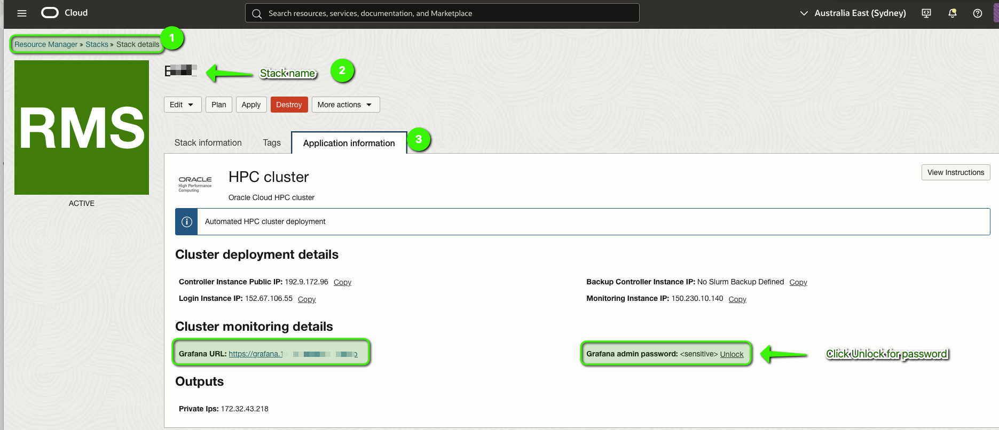

When both cluster LDAP and **Enable LDAP for Grafana UI** are enabled during stack deployment, Grafana also accepts the same LDAP username and password used on the controller. If the Grafana LDAP option is left unchecked, Grafana uses local Grafana users only. Local Grafana `admin` access remains available as a break-glass account. To disable Grafana LDAP later on an already deployed cluster, run `scripts/ldap/disable_grafana_ldap.py` on the Grafana host.

Grafana role mapping is driven by LDAP group membership:

| LDAP Group DN | Grafana Role |
| --- | --- |
| `cn=grafana-admins,ou=Group,dc=local` | Admin |
| `cn=grafana-editors,ou=Group,dc=local` | Editor |
| any other authenticated LDAP user | Viewer |

You can create and manage the LDAP groups from the controller:

```bash
sudo cluster group create grafana-admins
sudo cluster group create grafana-editors
sudo cluster group add grafana-admins alice
sudo cluster group add grafana-editors bob
```

Grafana creates the user record automatically on first successful LDAP login.

### Dashboards

Once you log in to Grafana, open 'Dashboards' from the left-hand menu to see the list of pre-built dashboards included with the deployment. Always start with the **Command Center** dashboard, which has context-sensitive links to open other dashboards.

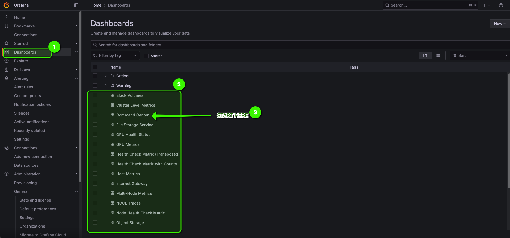

### Command Center

The command center is where you get a quick view of **cluster health** to determine what to focus on. It consists of three panels:
1. Node and GPU count panel — shows available nodes and GPUs and their health.
2. Health of individual nodes.
3. Historical node health.

> Keep in mind that this dashboard shows node health; it does not indicate GPU availability for scheduling jobs.

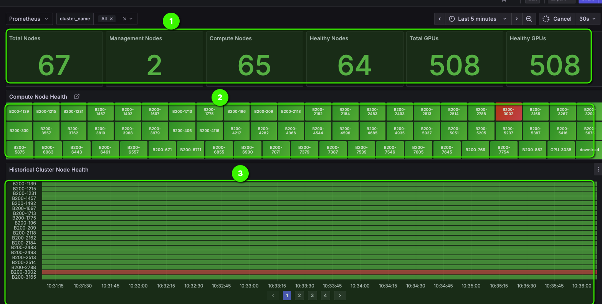

### Context Menus

There are two sets of context-sensitive dashboards:
- Cluster 
    - Cluster Level Metrics
    - Multi Node Metrics
- Host/Node
    - Host Metrics
    - Storage Metrics
    - GPU Metrics
    - GPU Health

Host/Node dashboards display one node at a time. Use the Command Center context menu to open them for a specific node, or select the intended hostname from the dashboard variable.

You can access these menus as shown in the screenshots below.

Cluster Context:
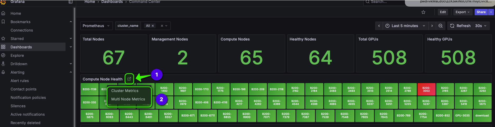

Node Context:
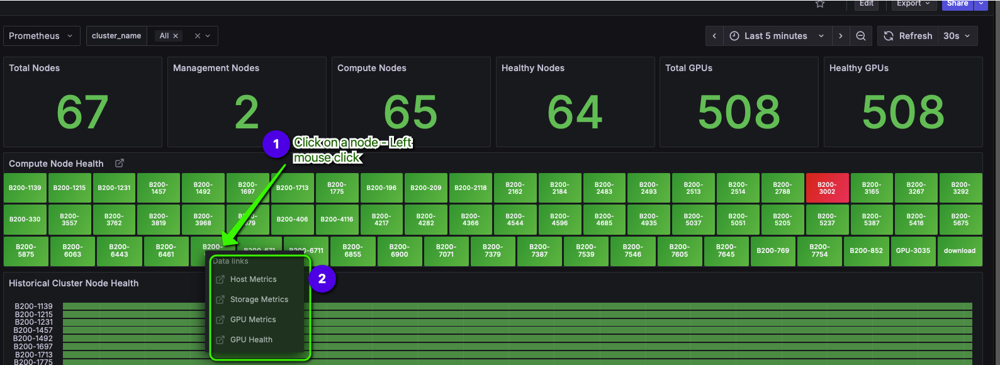

### Alerts

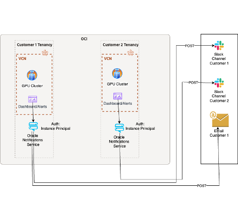

The monitoring stack includes pre-built alerts with pre-configured thresholds based on our experience supporting customer clusters. You can add, modify, or remove alerts as needed.

We include several Prometheus recording rules to calculate health scores for GPU nodes.

See screenshots below.
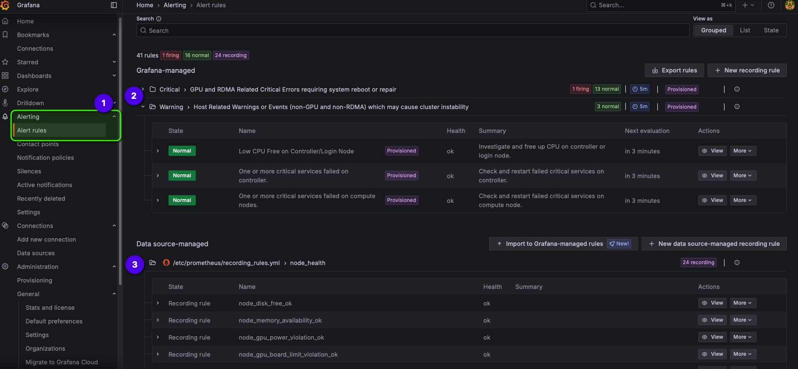

### Subscriptions 

By default, alerts can be delivered to Oracle internal Slack channels. For customer support, we maintain customer-specific Slack channels where engineers provide follow-the-sun monitoring and response.

To set up a subscription for alerts, locate the alert's OCI Notification Service topic as shown below, then click 'Subscriptions' and 'Create Subscription'. See the example below for adding a Slack webhook to a subscription.

Alert Topic:
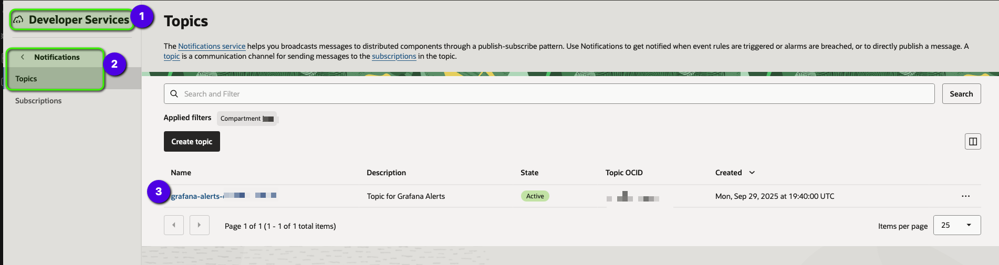

Topic Subscription:
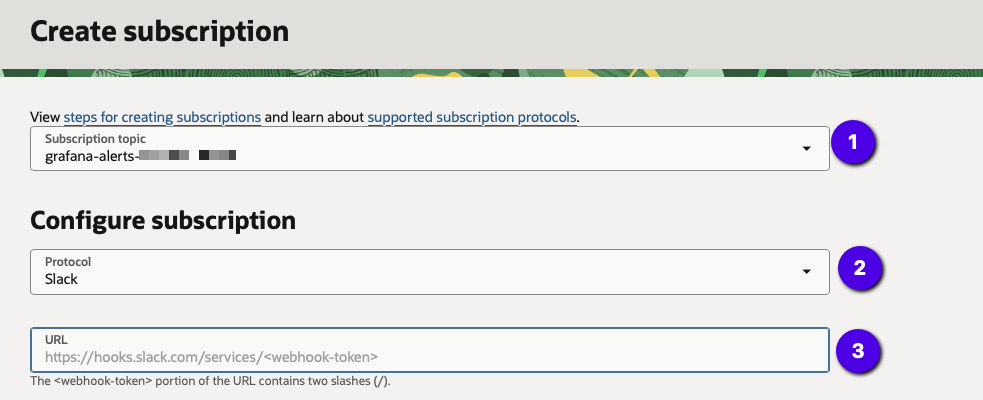

In addition to Slack, we support several other subscription delivery methods:
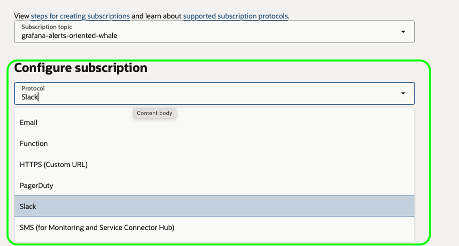


## Operations

### Systemd 

Exporters, Prometheus, and Grafana are all systemd services. You can view their status or start and stop them by running the following commands. You can find the service names in the **Monitoring Configuration** section.

```bash
sudo systemctl status <service-name>
sudo systemctl restart <service-name>
sudo systemctl stop <service-name>

```

### LDAP Validation

Use the following checks when validating Grafana LDAP behavior after deployment or after using the helper scripts on an existing cluster.

| Scenario | Expected result |
| --- | --- |
| Deploy with monitoring enabled, cluster LDAP enabled, and **Enable LDAP for Grafana UI** unchecked | `/etc/grafana/grafana.ini` contains `[auth.ldap] enabled = false`, `/etc/grafana/ldap.toml` is absent, and Grafana continues to use local Grafana users only. |
| Deploy with monitoring enabled, cluster LDAP enabled, and **Enable LDAP for Grafana UI** checked | `/etc/grafana/grafana.ini` contains `[auth.ldap] enabled = true`, `/etc/grafana/ldap.toml` exists as `root:grafana` with mode `0640`, and an LDAP user from the controller can log in to Grafana. |
| Run `scripts/ldap/disable_grafana_ldap.py` on an LDAP-enabled Grafana host | `/etc/grafana/ldap.toml` is removed, `[auth.ldap] enabled = false`, local `admin` login still works, and LDAP login is rejected. |
| LDAP-enabled Grafana with existing provisioning | The service account token file `/etc/grafana/.token` remains valid, datasources can still be provisioned, and dashboard updates can still be pushed through the existing service account token flow. |

### Password Management

When Grafana LDAP is enabled, there are still two separate credential paths:

- Local Grafana `admin` remains a Grafana-managed account. Its password is independent of LDAP and can still be changed from the Grafana UI or through Grafana's admin/API flows.
- LDAP-backed Grafana users continue to use the same password as their cluster LDAP account on the controller.

To reset an LDAP user password from the controller:

```bash
sudo cluster user edit <username> -p '<new-password>'
```

If an LDAP user knows their current password and only wants to change it, they can also use the normal `passwd` flow from the controller or another LDAP-backed node.

If an LDAP user clicks Grafana's **Forgot your password?** link, it does not reset the LDAP password. LDAP password changes and resets must happen through the controller LDAP workflow.

### Alert Rules

If you would like to modify alert rules, SSH into the monitoring node. You will find `alert-rules.yaml` and `delete-rules.yaml` in `/etc/grafana/provisioning/alerting`. Modify thresholds in `alert-rules.yaml` as needed. If you do not want to receive an alert, configure it in `delete-rules.yaml`. Do not delete alert rules from `alert-rules.yaml`. Once alert rules are provisioned, Grafana expects CRUD operations to add or delete alerts.

### Recording Rules

Prometheus recording rules can be found in `/etc/prometheus/recording_rules.yml`. You can add or modify recording rules as needed. Do not delete existing recording rules, as many dashboards and alerts depend on them.

### Enable Monitoring After Deployment

For steps to enable monitoring after a cluster has already been deployed, see [Enable Monitoring After Deployment](EnableMonitoringAfterDeployment.md).

That guide covers enabling monitoring on an existing controller-hosted cluster and adding a dedicated monitoring node after the stack has already been deployed.
## Known issues

### Grafana public URL resolves to `8.8.8.8`

For a public deployment, the Grafana URL has the form `https://grafana.PUBLIC-IP.endpoint.oci-hpc.ai`. The DNS service behind `endpoint.oci-hpc.ai` only maps the embedded public IP when it is included in Oracle's published OCI public IP ranges. This restriction prevents the service from being used to map arbitrary Internet addresses.

If OCI allocates a new public IP range before the DNS service has refreshed its allowlist, the Grafana hostname can resolve to `8.8.8.8` instead of the instance public IP. Let's Encrypt then reaches `8.8.8.8` during TLS validation, and Caddy cannot obtain a certificate.

Verify the resolution before retrying certificate issuance:

```bash
dig +short A grafana.PUBLIC-IP.endpoint.oci-hpc.ai
```

To check whether the URL's embedded public IP is in Oracle's current published ranges, replace the URL in the first line and run:

```bash
grafana_url='https://grafana.PUBLIC-IP.endpoint.oci-hpc.ai'
public_ip="$(printf '%s\n' "$grafana_url" | sed -E 's#^https?://##; s#^grafana\.([0-9.]+)\.endpoint\.oci-hpc\.ai/?$#\1#')"
curl -fsSL https://docs.oracle.com/en-us/iaas/tools/public_ip_ranges.json | python3 -c '
import ipaddress, json, sys
ip = ipaddress.ip_address(sys.argv[1])
cidrs = (item["cidr"] for region in json.load(sys.stdin)["regions"] for item in region["cidrs"])
print(f"{ip} is in the published OCI ranges" if any(ip in ipaddress.ip_network(cidr) for cidr in cidrs) else f"{ip} is NOT in the published OCI ranges")
' "$public_ip"
```

The response must be the Grafana host's public IP. If it returns `8.8.8.8`, do not repeatedly restart Caddy or rerun the stack. Report the public IP and the DNS result to the service owner, then allow up to 24 hours for the OCI CIDR allowlist refresh to take effect.

As a temporary client-side workaround, add the Grafana public IP and FQDN to `/etc/hosts` on each workstation that needs to access Grafana. For example, add this line to `/etc/hosts` when the public IP is `149.118.132.216`:

```text
149.118.132.216 grafana.149.118.132.216.endpoint.oci-hpc.ai
```

This mapping applies only to that workstation; it does not update public DNS or fix Let's Encrypt validation. Use it only after Caddy has obtained a valid certificate for the FQDN.

Reference URLs:

- Oracle public IP ranges: https://docs.oracle.com/en-us/iaas/tools/public_ip_ranges.json
- Oracle IP address ranges documentation: https://docs.oracle.com/en-us/iaas/Content/General/Concepts/addressranges.htm
