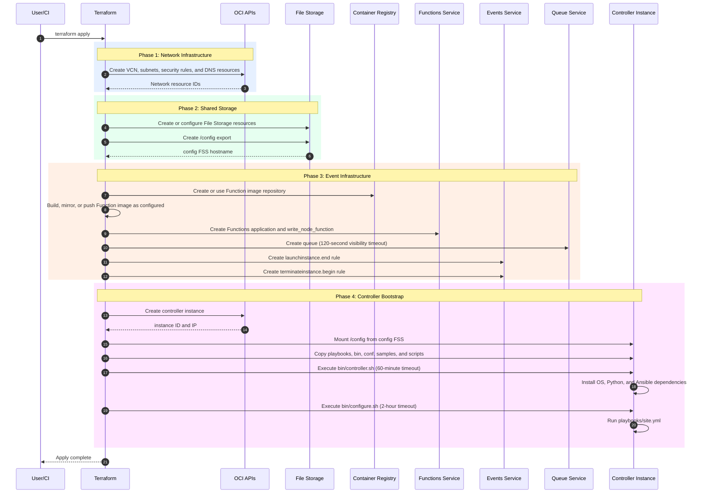
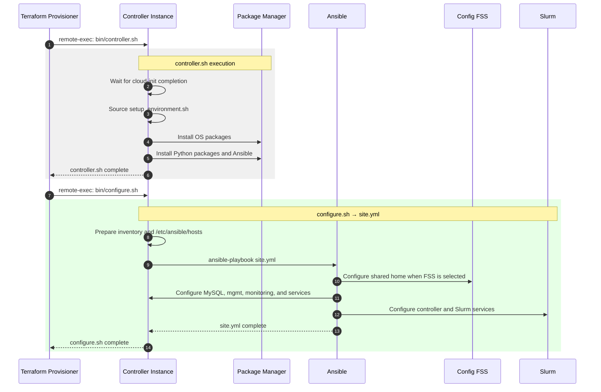
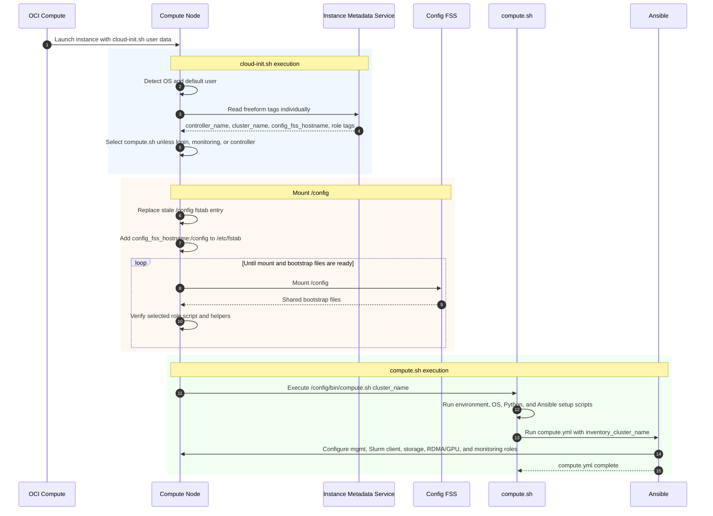
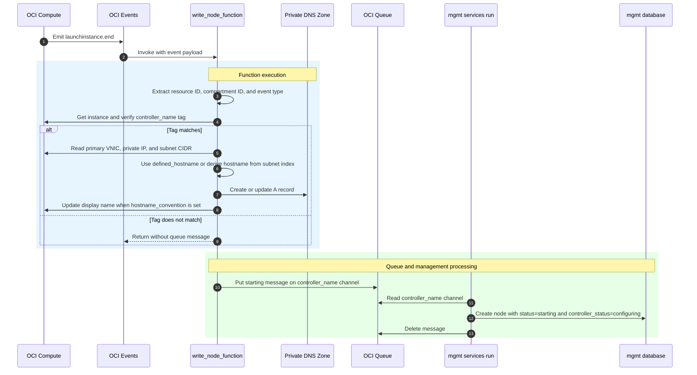
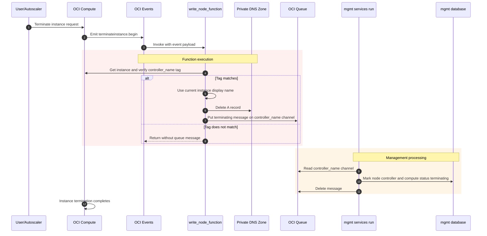
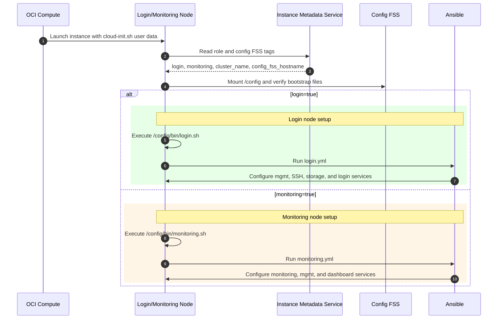
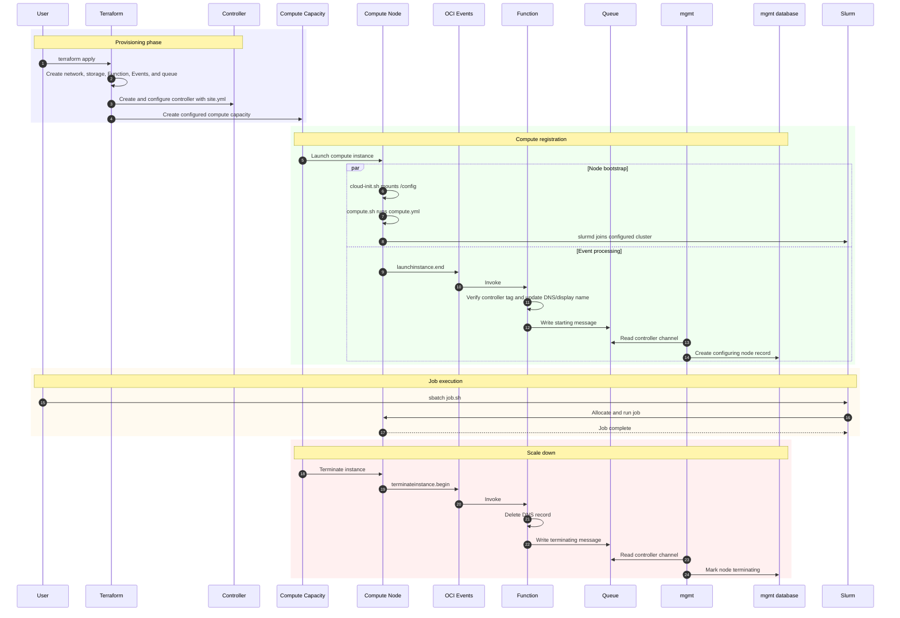
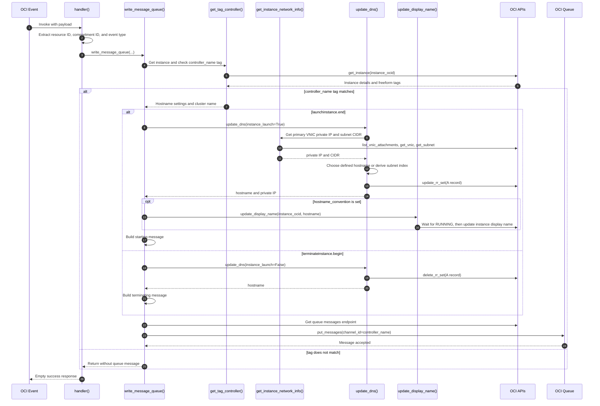

# OCI HPC Cluster Network - Architecture Diagram

This document describes the architecture and execution flow of the OCI HPC Cluster Network Terraform and Ansible stack. It reflects the current repository implementation.

## Sequence Diagrams

### 1. Terraform Apply - Complete Provisioning Flow

Shows how Terraform creates the core network, shared storage, event resources, and controller configuration in a single apply.

### 2. Controller Setup Detail

Shows the controller bootstrap scripts and the initial `site.yml` configuration that establishes controller services.

### 3. Compute Node Boot Sequence

Shows how a compute node uses instance metadata to mount `/config` and run its role-specific Ansible bootstrap.

### 4. Instance Launch Event - Runtime Flow

Shows how an instance launch event updates DNS and records a newly starting node through the Function, queue, and `mgmt` service.

### 5. Instance Terminate Event - Runtime Flow

Shows how a termination event removes the DNS record and marks the corresponding node as terminating in the management database.

### 6. Login/Monitoring Node Boot Sequence

Shows how role metadata selects the login or monitoring bootstrap and its corresponding Ansible playbook.

### 7. Complete End-to-End Flow

Shows the relationship between provisioning, compute bootstrap, event-driven management state, Slurm job execution, and scale down.

### 8. Function (func.py) Internal Flow

Shows the Function's tag validation, hostname and DNS processing, and controller-channel queue write for each event type.

